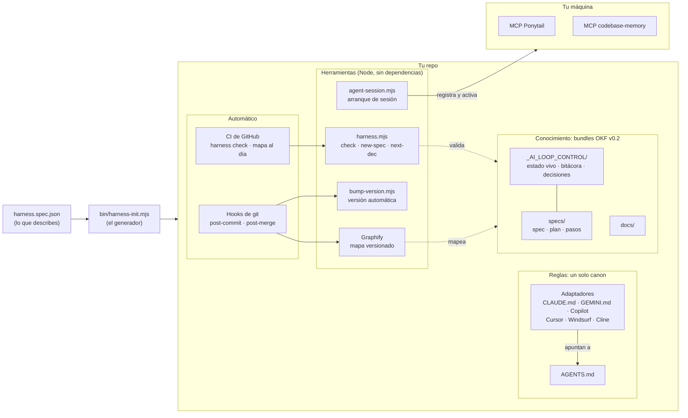
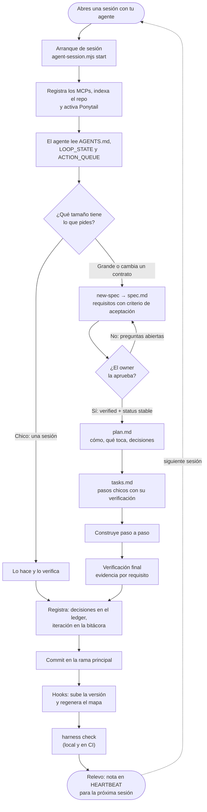

# harness-loop-control

**Una plantilla para que los agentes de IA trabajen en tus repos con memoria, reglas claras y sin
perder el hilo, sea cual sea la marca del agente.**

Si trabajas con agentes (Claude, Codex, Gemini, Copilot, Cursor…), seguro te ha pasado:

- cada sesión empieza de cero y tienes que volver a explicar en qué ibas;
- una decisión que tomaste la semana pasada nadie la recuerda, y el agente propone lo contrario;
- cada herramienta tiene su propio archivo de instrucciones, y al final dicen cosas distintas;
- el agente dice «listo» y no queda claro qué probó y qué no.

Esta plantilla instala en cualquier repo un **harness**: un conjunto acotado de archivos donde vive el
estado del trabajo, las decisiones y las reglas. Cualquier agente (o persona) los lee al empezar y
sabe exactamente dónde está parado. Y como el trabajo grande se escribe primero como una **spec**
(qué queremos y cómo sabremos que está bien), lo que el agente construye se puede verificar contra
algo concreto.

---

## Índice

- [Qué arma en tu repo](#qué-arma-en-tu-repo)
- [Cómo fluye el trabajo](#cómo-fluye-el-trabajo)
- [Los componentes, uno por uno](#los-componentes-uno-por-uno)
- [En 5 minutos](#en-5-minutos)
- [Qué te queda en el repo](#qué-te-queda-en-el-repo)
- [El día a día](#el-día-a-día)
- [Funciona con cualquier agente](#funciona-con-cualquier-agente)
- [Si algo no funciona](#si-algo-no-funciona)
- [Referencia: la spec del harness](#referencia-la-spec-del-harness)
- [Mantener esta plantilla](#mantener-esta-plantilla)
- [Licencia](#licencia)

---

## Qué arma en tu repo

Escribes una spec del harness, el generador la lee y deja armado este stack. Todo vive en el repo,
salvo los MCPs, que están instalados en tu máquina y se conectan solos.



## Cómo fluye el trabajo

Así se ve una sesión de punta a punta, con cualquier agente:



## Los componentes, uno por uno

| Componente | Qué hace | Cuándo actúa | Dónde vive | ¿Se puede apagar? |
|---|---|---|---|---|
| **Spec del harness** | Describe tu repo: productos, owners, ramas, cómo se verifica cada parte y qué módulos quieres. | Una vez, al instalar; después manda `harness.json`. | `harness.spec.json` → `_AI_LOOP_CONTROL/harness.json` | — |
| **Generador** | Valida la spec y crea todos los archivos, sin pisar los que ya existen. | Al instalar o al reinstalar. | `bin/harness-init.mjs` (en esta plantilla) | — |
| **Canon** | Las reglas de la casa: cómo se trabaja, qué está prohibido, cómo se verifica. Es el único lugar con reglas. | Lo lee el agente al empezar cada sesión. | `AGENTS.md` | No |
| **Adaptadores** | Hacen que cada herramienta lea el canon. No tienen reglas propias. | Los carga la herramienta al abrir el repo. | `CLAUDE.md`, `GEMINI.md`, `.cursor/`, `.github/`, `.windsurf/`, `.clinerules/` | Sí: `adapters` |
| **Bus de estado** | La memoria del trabajo: en qué estamos, qué sigue, quién hace qué y la nota de relevo. | Se lee al empezar y se reescribe al cambiar de tarea. | `_AI_LOOP_CONTROL/LOOP_STATE.md`, `ACTION_QUEUE.md`, `AGENT_BOARD.md`, `HEARTBEAT.json` | No |
| **Bitácora y decisiones** | El historial que no se borra: qué se hizo en cada iteración y cada decisión con su porqué. | Al cerrar una iteración o tomar una decisión. | `ITERATION_LOG.md`, `DECISION_LEDGER.jsonl` | No |
| **Specs** | El trabajo grande se escribe antes de construirse: qué y por qué, cómo, y los pasos con su verificación. | Cuando pides algo de varias sesiones o que cambia un contrato. | `_AI_LOOP_CONTROL/specs/<id>/spec.md`, `plan.md`, `tasks.md` | No |
| **OKF** | Pone a todos los documentos en el formato abierto de Google: frontmatter con tipo, autor, quién lo aprobó y estado. | Cada vez que se crea o cambia un documento. | El frontmatter de cada `.md` de `_AI_LOOP_CONTROL/` y `docs/` | No |
| **`harness.mjs`** | Crea specs (`new-spec`), da el próximo número de decisión (`next-dec`) y revisa que todo cuadre (`check`): ledger, heartbeat, índice de specs y OKF. | Cuando lo corres, al cerrar una sesión y en CI. | `scripts/harness.mjs` | No |
| **Arranque de sesión** | Encuentra los MCPs de tu máquina, los registra en cada herramienta, indexa el repo y le dice al agente qué activar. | Al abrir cada sesión (hook en Claude Code y Cursor; el agente en las demás) y en `npm install`. | `scripts/agent-session.mjs` | Sí: sin Ponytail ni codebase-memory no se genera |
| **Ponytail** | Hace que el agente busque el cambio más chico que resuelve todo, sin agregar lo que nadie pidió. | Toda la sesión. | MCP en tu máquina + resumen en `AGENTS.md` | Sí: `ponytail.enabled` |
| **Codebase memory** | Un índice del código en tu máquina para responder preguntas de estructura y relaciones. | Se indexa al arrancar la sesión; el agente lo consulta cuando lo necesita. | MCP en tu máquina | Sí: `codebase_memory.enabled` |
| **Graphify** | Un mapa versionado del código (o de los documentos): quién usa qué y qué se rompe si tocas algo. | Se consulta a pedido; se regenera solo en cada commit en la rama principal. | `scripts/graphify/`, `.graphify/graph.json` | Sí: `graphify.engine: none` |
| **Versión automática** | Sube la versión según el encabezado del commit (`feat`, `fix`, `feat!`). | En cada commit o merge en la rama principal. | `scripts/bump-version.mjs` | Sí: `versioning.enabled` |
| **Hooks de git** | Corren la versión y el mapa dentro del mismo commit. No frenan nunca un commit y se apagan durante un rebase. | Después de cada commit y de cada merge local. | `.githooks/post-commit`, `post-merge` | Se apagan si no hay versión ni mapa |
| **CI** | Repite el `check` y verifica que el mapa esté al día en cada push y PR. | En GitHub, en cada push a las ramas principales y en cada PR. | `.github/workflows/harness.yml` | Sí: `ci: none` |

---

## En 5 minutos

**Necesitas:** Node 22 o más nuevo y git. Nada más; la plantilla no tiene dependencias.

### 1. Clona la plantilla

```bash
git clone git@github.com:NeiKid/harness-loop-control.git
cd harness-loop-control
```

### 2. Describe tu repo en una spec

Copia el ejemplo dentro del repo donde quieres instalar el harness y edítalo:

```bash
cp harness.spec.example.json ../mi-repo/harness.spec.json
```

Lo mínimo que tienes que cambiar:

- **`project`**: nombre, título y una o dos frases de para qué existe el repo.
- **`owners`**: quiénes deciden (tú y tu equipo).
- **`products`**: las líneas de trabajo del repo, cada una con un prefijo corto (`API`, `WEB`, `CORE`…).
  Si el repo es chico, con **uno** basta.
- **`verification`**: cómo se prueba cada parte (los comandos de test o build que ya usas).
- **`adapters`**: las herramientas que tu equipo usa de verdad.

El resto tiene valores por defecto razonables. La [referencia](#referencia-la-spec-del-harness)
explica cada campo.

### 3. Mira qué va a hacer, sin tocar nada

```bash
node bin/harness-init.mjs --spec ../mi-repo/harness.spec.json --target ../mi-repo --dry-run
```

Te muestra qué archivos crearía, cuáles completaría y cuáles ya existen (esos **no se tocan**).

### 4. Genera

```bash
node bin/harness-init.mjs --spec ../mi-repo/harness.spec.json --target ../mi-repo
```

Al terminar, el generador activa los hooks de git (versión y mapa), registra los MCPs que tengas
instalados (Ponytail, codebase-memory) en cada herramienta, construye el mapa del código, revisa
que todo quede consistente y te avisa si quedó algo marcado como `TODO(owner)` para completar a mano.

Después puedes borrar `../mi-repo/harness.spec.json`: su contenido ya quedó guardado en
`_AI_LOOP_CONTROL/harness.json`, que es la versión que manda de aquí en adelante.

> **¿Prefieres que lo haga un agente?** Pídele: *«sigue `harness-loop-control/BOOTSTRAP.md` para
> `../mi-repo`»*. Revisa el repo, te propone la spec, espera tu visto bueno y recién ahí genera.

---

## Qué te queda en el repo

| Archivo | Para qué sirve, en palabras simples |
|---|---|
| `AGENTS.md` | **Las reglas de la casa.** Lo primero que lee cualquier agente. Es el único lugar donde se escriben reglas. |
| `_AI_LOOP_CONTROL/LOOP_STATE.md` | **En qué estamos ahora**: qué spec está activa, en qué fase va, cuál es el siguiente paso. |
| `_AI_LOOP_CONTROL/ACTION_QUEUE.md` | **Lo que sigue**: máximo tres prioridades, más lo que está esperando una decisión tuya. |
| `_AI_LOOP_CONTROL/AGENT_BOARD.md` | **Quién está trabajando en qué** y qué límites tiene. |
| `_AI_LOOP_CONTROL/HEARTBEAT.json` | Lo mismo que los anteriores, en formato que un programa puede leer, con una nota de relevo para la próxima sesión. |
| `_AI_LOOP_CONTROL/DECISION_LEDGER.jsonl` | **El libro de decisiones.** Una decisión por línea, con el porqué y las alternativas que se descartaron. Nunca se borra nada. |
| `_AI_LOOP_CONTROL/ITERATION_LOG.md` | **La bitácora.** Qué se hizo en cada sesión, qué se verificó y qué no. Tampoco se borra nada. |
| `_AI_LOOP_CONTROL/IDEAS_VAULT.md` | El baúl de ideas: cosas para más adelante, que todavía no son trabajo. |
| `_AI_LOOP_CONTROL/specs/` | Una carpeta por trabajo grande, con su spec, su plan y sus pasos. |
| `_AI_LOOP_CONTROL/harness.json` | La configuración del harness (productos, prefijos, owners, ramas). |
| `scripts/harness.mjs` | El ayudante: crea specs, numera decisiones y revisa que todo cuadre. |
| `scripts/graphify/`, `.graphify/graph.json` | **El mapa del código**, versionado en el repo (si lo activaste). |
| `scripts/agent-session.mjs` | **El arranque de sesión**: activa Ponytail y codebase-memory en cualquier agente. |
| `scripts/bump-version.mjs`, `.githooks/` | **La versión automática**: sube sola con cada commit en la rama principal. |
| `CLAUDE.md`, `GEMINI.md`, `.cursor/…` | Adaptadores: solo dicen «lee `AGENTS.md`». No tienen reglas propias. |

Dos tipos de archivo, dos formas de tratarlos:

- **Vivos** (estado, cola, tablero, heartbeat): se **reescriben**. Son una foto del presente.
- **Históricos** (bitácora, decisiones): solo se **agregan** entradas al final. Si algo estuvo mal, se
  agrega una corrección que apunta a la entrada original.

### Todo el conocimiento en formato OKF

`_AI_LOOP_CONTROL/` y `docs/` siguen el
[Open Knowledge Format](https://github.com/GoogleCloudPlatform/knowledge-catalog/blob/main/okf/SPEC.md)
(OKF) v0.2, el estándar abierto de Google para guardar conocimiento como markdown con frontmatter
YAML. Cada documento arranca con un bloque así:

```yaml
---
type: Spec                                   # qué clase de documento es (lo único obligatorio)
title: "API-S01 — Login con SSO"
description: "Una frase que lo resume."
tags: [spec, API]
status: draft                                # draft | stable | deprecated
generated: { by: codex/gpt-5, at: 2026-11-02T10:00:00Z }     # quién lo escribió y cuándo
verified: { by: human:tu-usuario, at: 2026-11-03T09:00:00Z } # quién lo aprobó
---
```

Con eso:

- **Cualquier herramienta lo entiende**: un agente, un buscador o un catálogo que hable OKF lee
  tus specs y decisiones sin adaptarse a tu repo.
- **Queda claro qué está aprobado**: una spec que el owner aprobó lleva su nombre en `verified`.
  OKF la cuenta como «revisada por una persona», a diferencia de lo que solo escribió un agente.
- **Graphify lo aprovecha**: el mapa de documentos indexa `type`, `title`, `description` y `tags`, así
  que `npm run graph -- tag spec` o `search` encuentran cualquier documento.
- **`harness check` lo valida**: avisa si un documento no tiene frontmatter, le falta `type`, o si un
  `index.md` está mal armado.

---

## El día a día

### Empezar una sesión con un agente

No hace falta explicarle nada. Basta con:

> *«Lee `AGENTS.md` y sigue con lo que dice `LOOP_STATE.md`.»*

La mayoría de las herramientas ya cargan `AGENTS.md` solas gracias a los adaptadores; la frase sirve
igual para cualquier agente.

Lo primero que `AGENTS.md` le pide al agente es el **arranque de sesión**, que deja listos los MCPs:

```bash
node scripts/agent-session.mjs start
```

- **Registra Ponytail y codebase-memory** en la configuración de cada herramienta que uses. No hay
  que configurar nada a mano: el script los encuentra en lo que ya tienes registrado en tus agentes,
  en el `PATH` o en su ruta de instalación.
- **Indexa el repo en codebase-memory** la primera vez, en segundo plano, sin hacerte esperar.
- **Le dice al agente qué activar**: por ejemplo, cargar Ponytail en el nivel del repo.

En **Claude Code** y **Cursor** ni siquiera hay que pedirlo: un hook lo corre al abrir la sesión.
Con el resto de los agentes lo corre el propio agente, porque así lo dice `AGENTS.md`.

Los archivos de configuración que escribe (`.mcp.json`, `.cursor/mcp.json`, `.vscode/mcp.json`…)
llevan rutas de tu máquina, por eso quedan en `.gitignore`: cada persona los genera en la suya al
hacer `npm install` o al abrir la primera sesión. Si algo no aparece, `npm run agent:doctor` te dice
qué está instalado, qué falta y cómo resolverlo.

### Escribir los commits (la versión sube sola)

La versión del proyecto sube sola en cada commit en la rama principal, y **el encabezado del commit
decide cuánto**:

| Si el commit empieza con… | La versión pasa de 1.4.2 a… | Úsalo para |
|---|---|---|
| `feat: …` | **1.5.0** | Algo nuevo que mueve el producto |
| `fix: …`, `docs: …`, `refactor: …`, `chore: …` | **1.4.3** | Correcciones y cambios que no mueven el producto |
| `feat!: …` o `BREAKING CHANGE` en el cuerpo | **2.0.0** | Un cambio que rompe a quien lo usa |

- El salto queda **dentro del mismo commit**; no aparece un commit extra de versión.
- En las ramas de trabajo la versión no se toca. Cuando haces un merge a la rama principal, sube
  según el commit más fuerte que traiga la rama.
- Lo que tengas sin commitear no se cuela en el commit de la versión.
- ¿Necesitas saltarlo una vez? `SKIP_VERSION_BUMP=1 git commit …`.

### Pedir algo nuevo

Depende del tamaño:

- **Algo chico** (un bug, un ajuste, cabe en una sesión): pídelo directo. El agente lo hace y lo
  verifica.
- **Algo grande** (varias sesiones, cambia una API o algo que alguien usa, o necesita que decidas
  algo): va por el **ciclo spec-driven**:

```text
 Idea ──tú priorizas──▶ Spec ──tú apruebas──▶ Plan ──▶ Pasos ──▶ Construcción ──▶ Verificación ──tú cierras──▶ ✓
 (baúl)               (qué y por qué)      (cómo)   (en orden) (sesión a sesión)  (evidencia por requisito)
```

1. **Crea la spec:**

   ```bash
   node scripts/harness.mjs new-spec API login-sso "Login con SSO"
   ```

   Esto crea `_AI_LOOP_CONTROL/specs/API-S01-login-sso/` con tres archivos para completar y la agrega
   al índice. Puedes pedirle al agente que la redacte contigo.

2. **`spec.md` — qué y por qué.** El problema, el objetivo y los requisitos (R1, R2…). Cada requisito
   tiene un **criterio de aceptación**: algo concreto que cualquiera pueda comprobar. Si quedan
   preguntas abiertas, la spec sigue en *Borrador* y **no se escribe código**.
3. **Apruébala.** Anota tu nombre y la fecha en «Aprobada por» y cambia el estado en
   `specs/README.md`.
4. **`plan.md` — cómo.** Qué archivos toca, qué decisiones se toman (van al libro de decisiones) y
   cómo se va a verificar cada requisito.
5. **`tasks.md` — los pasos.** Chicos, cada uno con el requisito que cubre y cómo se comprueba. El
   agente los va marcando a medida que avanza.
6. **Verificación final.** Para cada requisito: la evidencia, o la razón explícita de por qué no se
   pudo verificar. Con eso la cierras.

Estados de una spec: **Borrador → Aprobada → En curso → Verificada → Cerrada** (o **Descartada**).
El estado que vale es el de `specs/README.md`.

### Registrar una decisión

Cuando se decide algo que vale la pena recordar (una tecnología, un alcance, un «esto no»), se agrega
una línea al libro de decisiones. Para saber qué número le toca:

```bash
node scripts/harness.mjs next-dec API     # → API/dec/007
```

La numeración es **una sola para todo el repo**, así un número nunca se repite entre productos. El
formato de la línea está en `_AI_LOOP_CONTROL/README.md`. Si una decisión cambia, no se edita: se
agrega una nueva con `"supersedes": "API/dec/003"`.

### Cerrar una sesión

Antes de cortar, el agente (o tú) deja:

- una entrada en la bitácora: qué se hizo, qué se verificó, qué quedó sin verificar y qué sigue;
- los archivos vivos al día;
- una nota de relevo en `HEARTBEAT.json`, para que la próxima sesión arranque sin preguntar.

Y comprueba que todo cuadre:

```bash
node scripts/harness.mjs check
# harness: ok (12 decisiones, 3 specs)
```

Si algo no cuadra (un número de decisión repetido, una spec fuera del índice, el heartbeat apuntando
a una decisión que no existe), te dice exactamente qué y dónde.

### Usar el mapa del código

Si activaste Graphify, el repo tiene un mapa de quién usa qué. Sirve para responder rápido
preguntas como «dónde se define esto» o «qué se rompe si toco esto»:

```bash
npm run graph -- symbol crearUsuario        # dónde se declara
npm run graph -- file src/api/usuarios.ts   # qué importa y quién lo importa
npm run graph -- neighbors src/api/usuarios.ts --depth 2
npm run graph -- gods                       # los archivos de los que más cosas dependen
```

El mapa se actualiza solo cuando haces commit en la rama principal. Una advertencia que el propio
`AGENTS.md` repite: **el mapa es una brújula, no la verdad**. Si dice que algo no existe, se confirma
con una búsqueda antes de creerle.

### Trabajar con varias personas

- Cada tarea vive en una rama corta (`api/login-sso`) de uno a tres días, y se integra a la rama
  principal.
- La bitácora y el libro de decisiones se fusionan solos en git, sin conflictos.
- Si dos ramas usaron el mismo número de decisión, `harness check` lo detecta; quien integra
  renumera la suya.
- Cada producto tiene su sección en los archivos vivos, así nadie pisa lo del otro.

### Cambiar las reglas o agregar un producto

- **Una regla nueva o distinta:** se edita `AGENTS.md`, nunca un adaptador. Si contradice algo
  anterior, se reescribe el canon; la historia queda en el libro de decisiones.
- **Un producto nuevo:** se agrega en `_AI_LOOP_CONTROL/harness.json` y en la tabla de `AGENTS.md`, en
  el mismo cambio.

---

## Funciona con cualquier agente

Hay **un solo** archivo de reglas, `AGENTS.md`. Cada herramienta llega a él a su manera:

| Herramienta | Qué se genera | Cómo llega a las reglas |
|---|---|---|
| Codex, OpenCode | nada | Leen `AGENTS.md` directamente |
| Claude Code | `CLAUDE.md` | Lo importa con `@AGENTS.md` |
| Gemini CLI | `GEMINI.md` | Lo importa con `@./AGENTS.md` |
| GitHub Copilot | `.github/copilot-instructions.md` | Le indica leer `AGENTS.md` |
| Cursor | `.cursor/rules/harness.mdc` | Regla siempre activa que apunta a `AGENTS.md` |
| Windsurf | `.windsurf/rules/harness.md` | Regla siempre activa que apunta a `AGENTS.md` |
| Cline | `.clinerules/harness.md` | Le indica leer `AGENTS.md` |

Nada en el harness depende de un modelo o de un proveedor. Lo que sí depende de lo que tengas
instalado está escrito como **opcional**:

- **Ponytail**: el modo «el cambio más chico que resuelve todo». Sus reglas vienen resumidas en
  `AGENTS.md`, así que se aplican siempre. Si lo tienes instalado, el arranque de sesión lo registra
  en tu agente y le pide cargarlo al empezar.
- **Codebase memory**: si tienes `codebase-memory-mcp` instalado, el arranque de sesión lo registra,
  indexa el repo y el agente lo usa como complemento del mapa. Si no, sigue sin él. Las decisiones
  nunca se guardan ahí: solo en el libro de decisiones.

| Herramienta | Dónde registra los MCPs el arranque | ¿Arranca solo? |
|---|---|---|
| Claude Code | `.mcp.json` (ya aprobados en `.claude/settings.json`) | Sí, hook `SessionStart` |
| Cursor | `.cursor/mcp.json` | Sí, hook `sessionStart` |
| Gemini CLI | `.gemini/settings.json` | Lo corre el agente |
| GitHub Copilot (VS Code) | `.vscode/mcp.json` | Lo corre el agente |
| OpenCode | `opencode.json` | Lo corre el agente |
| Codex | `.codex/config.toml` | Lo corre el agente |
| Windsurf, Cline | Solo leen MCPs de su configuración global: `codebase-memory-mcp install` los registra ahí | Lo corre el agente |
- **La memoria propia de cada agente** no cuenta como fuente de verdad. Lo que importa queda escrito
  en el harness, donde lo ve cualquiera.

---

## Instalar en un repo que ya existe

Se puede, y es seguro:

- Los archivos que ya existen **no se tocan** (salvo que uses `--force`). Al final te lista cuáles
  fueron.
- `.gitattributes` y `package.json` se **completan**: se les agrega solo lo que falta. Si ya tenías un
  script con el mismo nombre, te avisa en vez de pisarlo.
- Si el repo ya tenía instrucciones para agentes (otro `AGENTS.md`, un `CLAUDE.md`, reglas de
  Cursor), pasa las reglas que sigan vigentes al `AGENTS.md` nuevo y deja los demás como adaptadores.
  [`BOOTSTRAP.md`](BOOTSTRAP.md) explica el paso a paso.

---

## Si algo no funciona

| Síntoma | Qué hacer |
|---|---|
| El mapa no se actualiza al hacer commit | Revisa que los hooks estén activos: `git config core.hooksPath` debe decir `.githooks`. Si no, corre `npm install` (lo configura el script `prepare`) o `git config core.hooksPath .githooks`. El mapa solo se regenera en la rama principal. |
| «El mapa no se pudo generar todavía» | Con el motor `code` falta TypeScript: `npm install` y luego `npm run graph:build`. |
| `harness check` dice «la secuencia es global» | Dos decisiones comparten número (típico al integrar ramas). Renumera la tuya con `next-dec`. |
| `harness check` dice que una spec «no está en specs/README.md» | Se creó la carpeta a mano. Agrega la fila al índice, o usa siempre `new-spec`. |
| La consulta del mapa avisa que está atrasado | Normal en una rama de trabajo. Corre `npm run graph:build` si lo necesitas, sin commitear el resultado. |
| En Git Bash una regex del mapa se convierte en ruta | Escribe `re:^patron` en vez de `/^patron/`. |
| El agente no ve las herramientas de Ponytail o codebase-memory | Corre `npm run agent:doctor`. Si dice «NO ENCONTRADO», instala el MCP o define su ruta en `PONYTAIL_MCP` / `CODEBASE_MEMORY_MCP`. Si estaba recién registrado, reinicia la sesión del agente. |
| La versión no sube | Solo sube en la rama principal y con los hooks activos (ver la primera fila). El primer commit del repo y los `fixup!` no la suben. |
| La versión subió de más (minor en vez de patch) | El encabezado decide: `feat` es minor. Corrígelo con un commit que deje la versión correcta; ese commit no vuelve a subirla. |
| Los hooks fallan en Windows con errores raros | Probablemente tienen fin de línea CRLF. El `.gitattributes` generado lo evita; si el repo ya existía, verifica que `.githooks/*` tenga `eol=lf`. |

---

## Referencia: la spec del harness

| Campo | Qué es | Si no lo pones |
|---|---|---|
| `project.name` | Nombre corto del repo (minúsculas, números y guiones) | Obligatorio |
| `project.title` | Nombre legible | Obligatorio |
| `project.mission` | Una o dos frases: qué resuelve el repo | Queda un `TODO(owner)` |
| `owners[]` | `{ name, handle }`: quiénes deciden | Obligatorio |
| `products[]` | `{ prefix, name, code, source_of_truth }`. El primero es el «por defecto» | Obligatorio (al menos uno) |
| `branches` | `{ trunk, stable }`: rama de trabajo diario y rama estable | `dev` y `main` |
| `verification[]` | `{ change, command }`: cómo se verifica cada parte del repo | Queda un `TODO(owner)` |
| `rules.commit_attribution` | `true` permite que los commits mencionen a la herramienta o al modelo | Prohibido |
| `rules.extra[]` | Reglas propias de tu repo | Ninguna |
| `graphify.engine` | `code` (código TS/JS), `docs` (repos de documentos) o `none` | `code` |
| `ponytail` | `{ enabled, level }`, con nivel `lite`, `full` o `ultra` | Activo, `full` |
| `codebase_memory` | `{ enabled, auto_index, index_mode }`: registrar el MCP, indexar al arrancar la sesión y con qué profundidad (`fast`, `moderate` o `full`) | Activo, indexa, `fast` |
| `versioning` | `{ enabled, files }`: versión automática y en qué archivos vive (un `.json` con campo `version`, o un archivo de texto como `VERSION`) | Activo, `["package.json"]` |
| `adapters[]` | `claude`, `codex`, `gemini`, `copilot`, `cursor`, `windsurf`, `cline`, `opencode` | Ninguno |
| `ci` | `github` agrega un workflow que corre `harness check` y revisa el mapa | `github` |

Opciones del generador:

```text
node bin/harness-init.mjs --spec <archivo> --target <repo> [--dry-run] [--force]

  --dry-run   muestra qué haría, sin escribir nada
  --force     pisa archivos que ya existen (úsalo solo si sabes cuáles)
```

---

## Mantener esta plantilla

Las reglas para modificar la plantilla están en [`AGENTS.md`](AGENTS.md). Antes de publicar un
cambio:

```bash
npm test                 # generador, plantilla, hooks, MCPs (con una máquina falsa), OKF y motor docs
npm run test:code        # motor code de Graphify (necesita: npm install --no-save typescript)
```

CI corre los dos en Linux y Windows en cada push y PR (`.github/workflows/test.yml`).

### Graphify

Graphify es una utilidad aparte que esta plantilla integra. Sus dos motores, `code` (código TS/JS) y
`docs` (repos de documentos), vienen en [`engines/graphify/`](engines/graphify/) y el generador los
copia a `scripts/graphify/` del repo destino. Para actualizar Graphify, se reemplaza la carpeta del
motor por la versión nueva; no se edita acá. Lo que el harness espera de un motor está en
[`engines/graphify/README.md`](engines/graphify/README.md).

---

## Licencia

[MIT](LICENSE) © 2026 NeiKid. Puedes usarla, copiarla, modificarla y distribuirla, también con fines
comerciales, siempre que conserves el aviso de copyright y la licencia.
